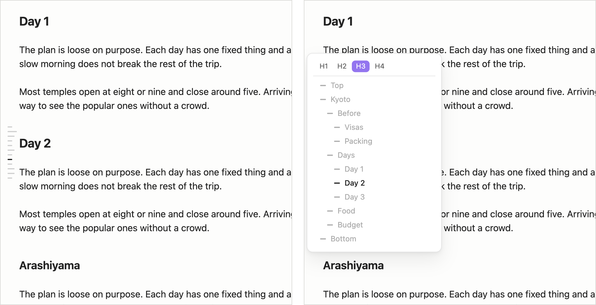
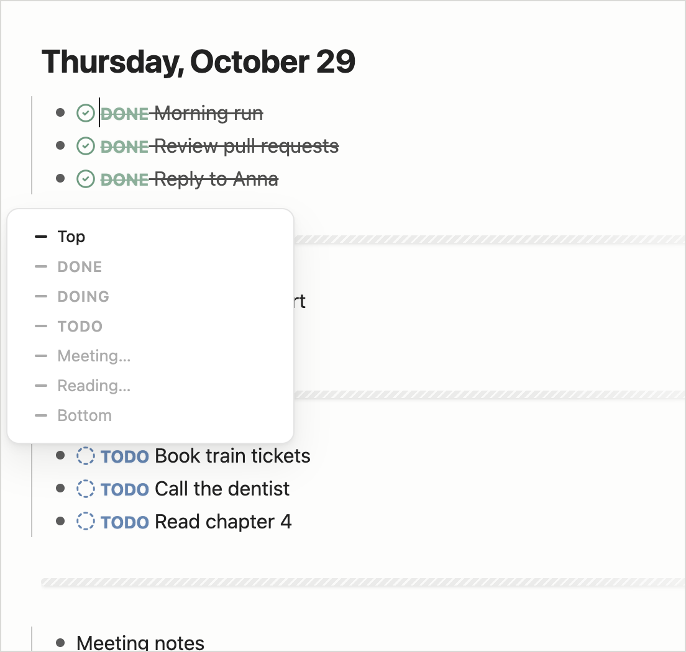

# Hover Outline

**English** · [简体中文](./README.zh-CN.md)

A hidden table of contents in a corner of the editor. It shows a column of short dashes (one per heading, the current one darker) and expands into an outline card on hover. Click an entry to jump there; the target line is centered.

- Choose the position in settings: left or right, top, middle or bottom (default: left, middle).
- Lists the top, headings (up to h3 by default, with a level switcher when deeper headings exist), and the bottom.
- Journal notes are split at horizontal rules into DONE / DOING / TODO sections. The journal folder follows the core Daily notes folder unless set in this plugin's settings.
- Hidden on notes containing dataview code blocks.
- On mobile, tap to open and tap again to close.

## Install

Download `main.js`, `manifest.json` and `styles.css` from [Releases](https://github.com/MatsuriMW/hover-outline/releases) into `<vault>/.obsidian/plugins/hover-outline/` and enable it under Settings → Community plugins. Or install with BRAT: `MatsuriMW/hover-outline`.

## Feedback and updates

To follow new features, send feedback or keep up with progress, follow me on Twitter: [@Matsurimywaifu](https://x.com/Matsurimywaifu).

## License

MIT
