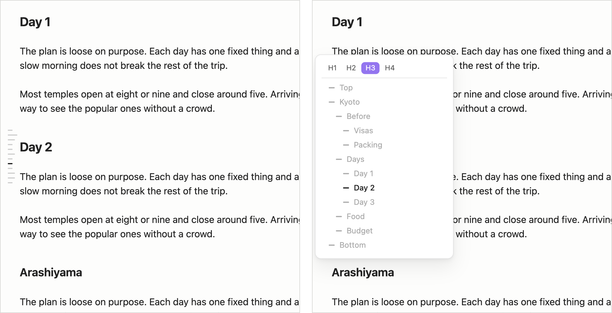
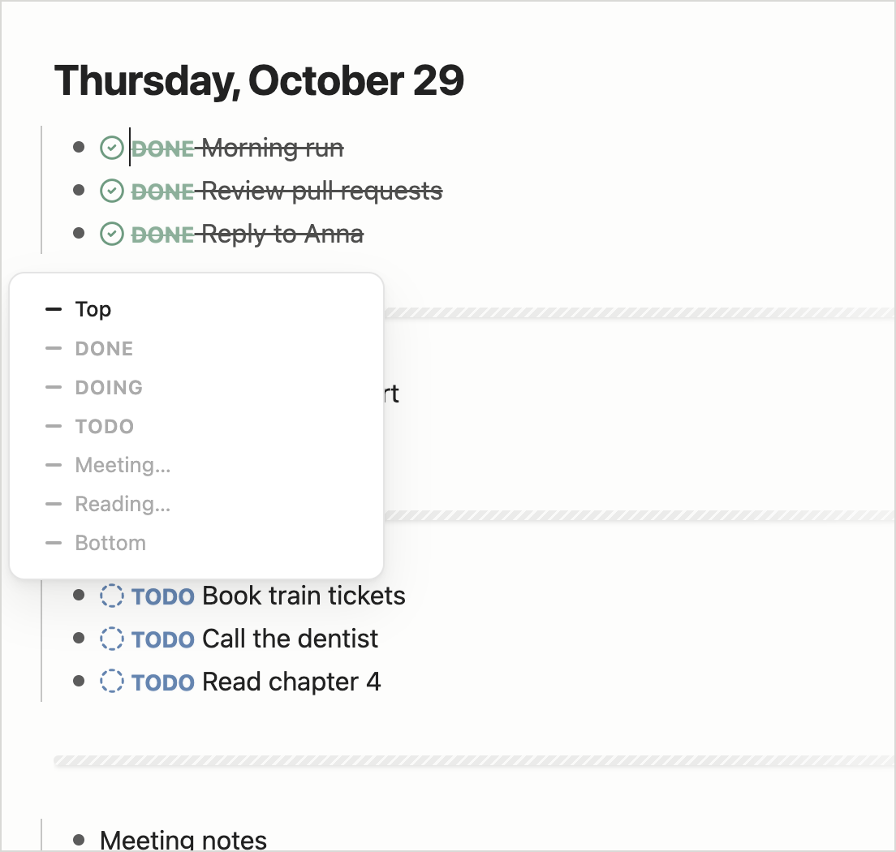

# Hover Outline

[English](./README.md) · **简体中文**

编辑区角落里一个隐藏式目录，仿 Claude Code 对话框左上角的目录：平时只有一列短横线（一条 = 一个目录项，当前位置那条加深），鼠标移上去展开成目录卡片，点击跳转，目标行停在视口正中。

**目录**

- [功能](#功能)
- [安装](#安装)
- [反馈与后续](#反馈与后续)
- [License](#license)

## 功能

- **位置可选**：设置里选左 / 右 × 上 / 中 / 下，默认左边中间。
- 目录 = 开头 + 标题 + 结尾。默认只列到 h3，笔记里有 h4 及更深的标题时，卡片顶上出现层级切换。
- **日记**：日记文件夹里的笔记按分割线分段，分出 DONE / DOING / TODO 区，其余段显示分割线下第一条。日记文件夹默认跟着核心插件「日记」（Daily notes）的设置，也可以在本插件设置里单独指定。
- 有 dataview 代码块的笔记不显示。
- 手机上点一下展开、再点收起。
- 界面文字跟着 Obsidian 的语言（中文 / 英文）。

## 安装

从 [Releases](https://github.com/MatsuriMW/hover-outline/releases) 下载 `main.js`、`manifest.json`、`styles.css`，放进库里的 `.obsidian/plugins/hover-outline/`，在 设置 → 第三方插件 里启用。也可以用 BRAT 装：`MatsuriMW/hover-outline`。

## 反馈与后续

想追踪后续功能、反馈问题、关注后续进展，欢迎关注我的 Twitter：[@Matsurimywaifu](https://x.com/Matsurimywaifu)。

## License

MIT
